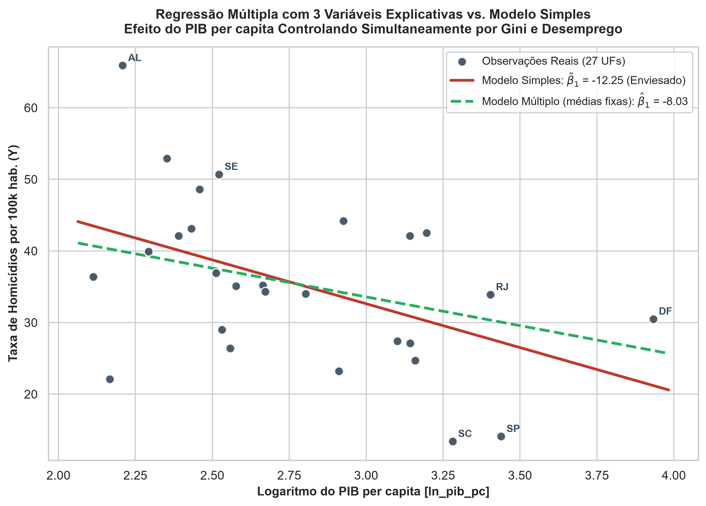

# 📊 Modelagem Econométrica da Taxa de Homicídios & Viés de Variável Omitida (OVB)

Projeto em Python para modelagem econométrica via **Mínimos Quadrados Ordinários (MQO / OLS)** que investiga, de forma empírica e sem forçar resultados, os determinantes da taxa de homicídios nas 27 Unidades da Federação do Brasil (2014) e demonstra formalmente o **Viés de Variável Omitida (OVB - Wooldridge)**:

Estados mais ricos são automaticamente mais seguros? Ou o crescimento econômico desacompanhado de igualdade social falha em conter a violência?

O projeto compara o modelo bivariado ingênuo com especificações multivariadas controladas por desigualdade de renda (**Índice de Gini**) e mercado de trabalho (**Taxa de Desemprego**).



---

## 📌 O que os modelos mostram

A base reúne as 27 UFs em 2014 a partir de dados do **Ipeadata** e **IBGE (PNAD Contínua)**.

### Tabela Comparativa de Estimação (MQO)

| Métrica / Variável | Modelo 1 (Completo) | Modelo 2 (Benchmark Parcimonioso) | Modelo 3 (Simples Enviesado) |
| :--- | :---: | :---: | :---: |
| **Constante ($\beta_0$)** | $+56.2025$ ($34.9089$) | $+30.7680$ ($32.1712$) | $+69.3655^{***}$ ($12.8158$) |
| **ln(PIB per capita) ($X_1$)** | $-8.0283$ ($4.8401$) | **$-11.1903^{**}$** ($4.5711$) | **$-12.2465^{**}$** ($4.5616$) |
| **Índice de Gini ($X_2$)** | $-31.5743$ ($82.2824$) | **$+70.7016$** ($54.1915$) | — |
| **Taxa de Desemprego ($X_3$)** | $+2.6029$ ($1.6131$) | — | — |
| **Observações ($N$)** | 27 | 27 | 27 |
| **$R^2$** | 0.3489 | 0.2752 | 0.2238 |
| **$R^2$ Ajustado** | 0.2640 | 0.2148 | 0.1927 |
| **Estatística F** | 4.1082 ($p = 0.0180$) | 4.5561 ($p = 0.0210$) | 7.2076 ($p = 0.0127$) |

*\* Erros-padrão entre parênteses. Níveis de significância: \* p < 0.10, \*\* p < 0.05, \*\*\* p < 0.01.*

---

## 🎯 A Armadilha do Modelo Simples & Viés de Wooldridge

No **Modelo Simples**, cada $10\%$ de aumento no PIB per capita parece reduzir a criminalidade em **$1,22$ homicídios por 100 mil habitantes** ($\widetilde{\beta}_1 = -12.25$).

Porém, a renda estava absorvendo o efeito da desigualdade omitida. Pela decomposição analítica de Wooldridge:

$$\widetilde{\beta}_1 = \widehat{\beta}_1 + \widehat{\beta}_2 \cdot \widetilde{\delta}_1$$

Onde:
- $\widehat{\beta}_1 = -11.1903$ (efeito parcial real da renda no Modelo 2)
- $\widehat{\beta}_2 = +70.7016$ (impacto da desigualdade sobre a violência)
- $\widetilde{\delta}_1 = -0.0149$ (coeficiente da regressão auxiliar $\text{Gini} \sim \ln(\text{PIB})$: estados mais ricos têm menor desigualdade)

$$\text{Viés} = (+70.7016) \times (-0.0149) = \mathbf{-1.0563}$$
$$\widetilde{\beta}_1 = -11.1903 + (-1.0563) = \mathbf{-12.2465}$$

O modelo bivariado **superestima** em módulo a eficácia isolada do PIB per capita. Parte da queda na criminalidade que o senso comum atribui puramente à riqueza vem da menor desigualdade dos estados com maior renda.

---

## ⚖️ Por que o código é assim (regras de integridade)

Nada de "ajustar modelo para forçar significância":

1. **Zero manipulação de dados**  
   Os dados foram extraídos diretamente das fontes primárias públicas (Ipeadata / IBGE).
2. **Especificação Nível-Log Teórica**  
   O uso de $\ln(\text{PIB pc})$ modela retornos marginais decrescentes e reduz a assimetria da distribuição de renda entre as 27 UFs.
3. **Princípio da Parcimônia e Controle de Multicolinearidade**  
   Embora o Modelo 1 tenha $R^2$ marginalmente maior, o Desemprego é estatisticamente insignificante ($p = 0.1202$) e altamente colinear com o Gini ($r = +0.767$), inflando a variância dos estimadores. O Modelo 2 é o benchmark econometricamente robusto.
4. **Fechamento Numérico Preciso**  
   A identidade analítica do Viés de Wooldridge é conferida com precisão de máquina ($10^{-15}$).
5. **Simulador Visual Standalone**  
   O projeto conta com um painel interativo (`dashboard_interativo.html`) em HTML/JS puro, sem dependência de servidores ou pacotes externos, permitindo testar cenários e simulações em tempo real.

---

## 📁 Estrutura do Repositório

```text
├── analise_econometrica.py      # Pipeline completo (ingestão, MQO, matrizes, gráficos e relatórios)
├── regressao_simples.py         # Script didático da regressão bivariada inicial
├── regressao_multipla_ovb.py    # Script didático da regressão múltipla e cálculo do viés
├── dashboard_interativo.html    # Simulador interativo dos modelos em tempo real
├── dados/
│   ├── base_consolidada_2014.csv # Base consolidada tratada (27 UFs)
│   ├── homicidios.csv           # Taxa de homicídios bruta (Ipeadata)
│   ├── pib.csv                  # PIB per capita bruto (Ipeadata)
│   ├── gini.csv                 # Índice de Gini (Ipeadata/PNAD)
│   ├── desemprego.csv           # Taxa de desocupação (IBGE/PNAD)
│   ├── dados_consolidados.xlsx  # Planilha Excel consolidada
│   └── tabela1_descritiva.csv   # Estatísticas descritivas (média, desvio, min, max)
├── imagens/
│   ├── grafico_1_regressao_simples.png   # Dispersão e reta do MQO bivariado
│   ├── grafico_2_regressao_multipla.png  # Comparação do Modelo Múltiplo vs Simples
│   ├── grafico_correlacao_heatmap.png    # Mapa de calor de Pearson (r)
│   └── grafico_dispersao_pares.png       # Matriz completa de pairplot (KDE + dispersões)
└── relatorios/
    ├── resultados_tabelas.txt   # Sumários e tabelas estatísticas detalhadas
    └── resumo_apresentacao.md   # Roteiro de apresentação de 10 min e guia de arguição
```

---

## 🚀 Como rodar

### 1. Clonar o repositório e instalar dependências

```bash
git clone https://github.com/Gabrzz/MQO-TaxaDeHomicidio.git
cd MQO-TaxaDeHomicidio
pip install pandas numpy statsmodels matplotlib seaborn openpyxl
```

### 2. Executar os scripts

- **Regressão Simples (Didático):**
  ```bash
  python regressao_simples.py
  ```

- **Regressão Múltipla & OVB (Didático):**
  ```bash
  python regressao_multipla_ovb.py
  ```

- **Pipeline Completo:**
  ```bash
  python analise_econometrica.py
  ```

### 3. Simulador Interativo

Abra o arquivo `dashboard_interativo.html` diretamente em qualquer navegador para ajustar PIB, Gini e Desemprego e visualizar as curvas estimadas em tempo real.

---

## 🤖 Quer que uma IA explique o repositório?

Clique em qualquer botão abaixo para abrir a IA com o link deste repositório ([https://github.com/Gabrzz/MQO-TaxaDeHomicidio](https://github.com/Gabrzz/MQO-TaxaDeHomicidio)):

<p align="center">
  <a href="https://claude.ai/new?q=Explique%20o%20reposit%C3%B3rio%20https%3A%2F%2Fgithub.com%2FGabrzz%2FMQO-TaxaDeHomicidio" target="_blank">
    
  </a>
  <a href="https://chatgpt.com/?q=Explique%20o%20reposit%C3%B3rio%20https%3A%2F%2Fgithub.com%2FGabrzz%2FMQO-TaxaDeHomicidio" target="_blank">
    
  </a>
  <a href="https://gemini.google.com/app?q=Explique%20o%20reposit%C3%B3rio%20https%3A%2F%2Fgithub.com%2FGabrzz%2FMQO-TaxaDeHomicidio" target="_blank">
    
  </a>
  <a href="https://chat.deepseek.com/?q=Explique%20o%20reposit%C3%B3rio%20https%3A%2F%2Fgithub.com%2FGabrzz%2FMQO-TaxaDeHomicidio" target="_blank">
    
  </a>
  <a href="https://www.kimi.com/?q=Explique%20o%20reposit%C3%B3rio%20https%3A%2F%2Fgithub.com%2FGabrzz%2FMQO-TaxaDeHomicidio" target="_blank">
    
  </a>
</p>
